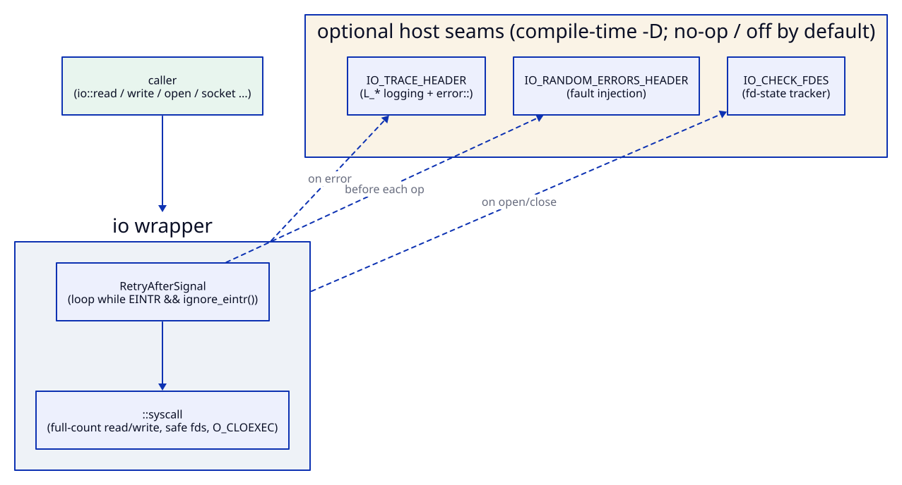

# io

Part of [Kronuz C++ Libraries](https://github.com/Kronuz/cpp-libraries), a collection of small, reusable C++ libraries.

[](https://github.com/Kronuz/io/actions/workflows/ci.yml)
[](LICENSE)


POSIX file and socket calls that do what a storage engine means, in C++20. Each
`io::` function mirrors the syscall of the same name, and retries on `EINTR`, loops
until the full count is transferred, and keeps data files off fds 0, 1, and 2.



## ✨ Highlights

- 🔁 **`EINTR` retry** for `read`, `write`, `send`, `recv`, `accept`, `connect`,
  `fsync`, and more. `close` deliberately never retries, since that can close a
  reused fd.
- 📏 **Full-count I/O**: `read`, `write`, and `pwrite` loop until the whole buffer
  moves, and return short only on a real error.
- 🛡️ **Safe descriptors**: `open()` sets `O_CLOEXEC` and never returns stdin, stdout,
  or stderr.
- 💾 **Durability that means it**: `fdatasync` on Linux, `F_FULLFSYNC` on macOS, and a
  portable `fallocate`.
- 🪶 **No dependencies**: logging, fault injection, and fd tracking are optional seams.

## 📦 Installation

Requires a C++20 compiler, a POSIX system, and CMake 3.14 or newer. CI builds it on
Linux (x86_64, arm64), macOS (arm64, x86_64), and FreeBSD, plus ASan, UBSan, and TSan
builds.

```cmake
include(FetchContent)
FetchContent_Declare(io
  GIT_REPOSITORY https://github.com/Kronuz/io.git
  GIT_TAG        main)
FetchContent_MakeAvailable(io)

target_link_libraries(my_app PRIVATE io::io)
```

## 🚀 Quick start

```cpp
#include "io.hh"

#include <fcntl.h>

int main() {
	char buf[] = "hello";
	int fd = io::open("data.bin", O_RDWR | O_CREAT, 0644);   // never 0, 1, or 2
	io::write(fd, buf, sizeof buf);       // all of it, or an error
	io::pread(fd, buf, sizeof buf, 0);    // positional read
	io::fsync(fd);
	io::close(fd);                        // no retry on EINTR, by design
}
```

## ⚙️ Configuration

| Seam | Define | Default | Purpose |
| --- | --- | --- | --- |
| Logging | `IO_TRACE_HEADER` | no-op | route `L_CALL`, `L_ERRNO`, `L_ERR` to your logger |
| Fault injection | `IO_RANDOM_ERRORS_HEADER` | off | fail operations at random, for resilience tests |
| fd tracking | `IO_CHECK_FDES` | off | catch double-close and use-after-close |
| Lowest fd | `IO_MINIMUM_FILE_DESCRIPTOR` | 3 | the smallest fd `open()` returns |

## 🎯 When to use it

- ✅ Storage and network code that must not lose writes to signals or short counts.
- ❌ Non-POSIX targets: there is no Windows backend.

## 📚 Documentation

- [ARCHITECTURE.md](ARCHITECTURE.md): each wrapper's semantics and how the seams stay
  dependency-free.
- [AGENTS.md](AGENTS.md): repository map and invariants.

## 🛠️ Building and testing

```sh
cmake -B build -DCMAKE_BUILD_TYPE=Release && cmake --build build
ctest --test-dir build
./build/io_bench      # io:: against the raw syscalls
```

## 🤝 Contributing

Issues and pull requests are welcome. Read [AGENTS.md](AGENTS.md) first. CI must
pass on every platform.

## 📄 License

MIT, Copyright (c) 2015-2019 Dubalu LLC. See [LICENSE](LICENSE). Extracted from
[Xapiand](https://github.com/Kronuz/Xapiand).
